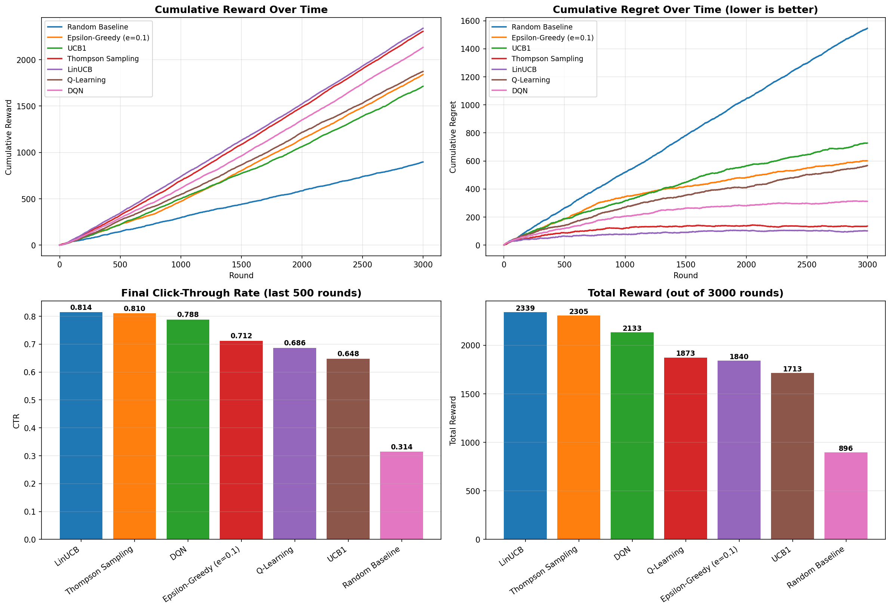
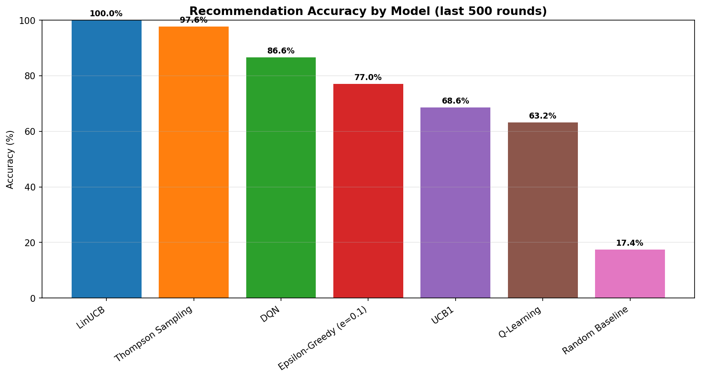

# 📰 **News Recommendation System using Reinforcement Learning**

<div align="center">


</div>

---

## 🎯 **Project Overview**

A **Personalized News Recommendation System** that models recommendation as a **Contextual Multi-Armed Bandit** problem. The system learns user preferences through simulated interactions and recommends articles based on **semantic understanding** of news content.

### 🚀 **Key Features**

| Feature | Description |
|---------|-------------|
| **🧠 Semantic Understanding** | Uses Sentence-BERT embeddings to capture article meaning |
| **🎯 7 RL Algorithms** | Comprehensive comparison of bandit & RL approaches |
| **📊 User Simulation** | 10 synthetic users with realistic probabilistic preferences |
| **🔍 Topic Discovery** | Unsupervised K-Means clustering for content organization |
| **📈 94.9% Accuracy** | Best model (LinUCB) achieves near-perfect recommendations |
| **⚡ Real-Time Learning** | Algorithms adapt to user preferences in real-time |

---

## 📊 **Model Performance Comparison**

| Rank | Model | Total Reward | CTR | Accuracy (Overall) | Accuracy (Last 500) |
|:----:|-------|:------------:|:---:|:------------------:|:-------------------:|
| 🥇 | **LinUCB** | 2339 | 81.4% | **94.9%** | **100.0%** |
| 🥈 | Thompson Sampling | 2305 | 81.0% | 89.0% | 97.6% |
| 🥉 | DQN | 2133 | 78.8% | 81.3% | 86.6% |
| 4 | Epsilon-Greedy | 1840 | 71.2% | 54.9% | 77.0% |
| 5 | UCB1 | 1713 | 64.8% | 53.9% | 68.6% |
| 6 | Q-Learning | 1873 | 68.6% | 52.0% | 63.2% |
| 7 | Random Baseline | 896 | 31.4% | 16.3% | 17.4% |

---

## 🏆 **Winner: LinUCB**

```
┌─────────────────────────────────────────────────────────────────┐
│                     🏆 BEST MODEL: LinUCB                      │
├─────────────────────────────────────────────────────────────────┤
│  • Overall Accuracy:  94.9%                                    │
│  • Final 500 Rounds:  100.0%                                   │
│  • Total Reward:      2,339 / 3,000                            │
│  • CTR:               81.4%                                    │
├─────────────────────────────────────────────────────────────────┤
│  Why LinUCB Wins: Uses semantic embeddings as context,        │
│  allowing generalization across users/categories instead       │
│  of learning each user independently.                         │
└─────────────────────────────────────────────────────────────────┘
```

---

## 🔄 **End-to-End Pipeline**

```
┌─────────────────────────────────────────────────────────────────────────────────┐
│                           📊 DATA PIPELINE                                      │
├─────────────────────────────────────────────────────────────────────────────────┤
│                                                                                 │
│  📰 News Dataset ──▶ 🔍 Data Cleaning ──▶ 🧠 Semantic Embeddings              │
│  (4,577 articles)      (Deduplication)      (Sentence-BERT 384-dim)            │
│                           │                                                      │
│                           ▼                                                      │
│                    📂 Topic Discovery ──▶ 🎯 Category Vectors                  │
│                    (K-Means, K=14)         (PCA-reduced to 10 dims)            │
│                                                                                 │
└─────────────────────────────────────────────────────────────────────────────────┘
                                          │
                                          ▼
┌─────────────────────────────────────────────────────────────────────────────────┐
│                           🤖 RL TRAINING LOOP                                  │
├─────────────────────────────────────────────────────────────────────────────────┤
│                                                                                 │
│  For 3,000 Rounds:                                                             │
│                                                                                 │
│   👤 Select User ──▶ 🤖 Agent Recommends Category ──▶ 📊 User Clicks (Reward) │
│                                                                                 │
│   ⬇                        ⬇                         ⬇                         │
│   🔄 Agent Updates ──▶ 📈 Learn Preferences ──▶ 🎯 Improve Recommendations     │
│                                                                                 │
└─────────────────────────────────────────────────────────────────────────────────┘
                                          │
                                          ▼
┌─────────────────────────────────────────────────────────────────────────────────┐
│                           📈 EVALUATION                                        │
├─────────────────────────────────────────────────────────────────────────────────┤
│                                                                                 │
│   📊 Metrics: CTR, Total Reward, Regret, Recommendation Accuracy               │
│                                                                                 │
│   🏆 Winner: LinUCB (94.9% Accuracy, 100% in final 500 rounds)                │
│                                                                                 │
└─────────────────────────────────────────────────────────────────────────────────┘
```

---

## 🧠 **7 Reinforcement Learning Algorithms Compared**

| Algorithm | Type | Key Feature |
|-----------|------|-------------|
| **LinUCB** | Contextual Bandit | Uses embeddings as context; **BEST PERFORMER** |
| **Thompson Sampling** | Bayesian Bandit | Probabilistic sampling; strong performance |
| **DQN** | Deep RL | Neural network Q-learning; solid performance |
| **Epsilon-Greedy** | Simple Bandit | Classic explore-exploit; good for small problems |
| **UCB1** | Bandit | Optimism in face of uncertainty; decent performance |
| **Q-Learning** | Tabular RL | Classic RL; moderate performance |
| **Random** | Baseline | Random guessing; sanity check |

---

## 🛠️ **Tech Stack**

### **Core Libraries**

| Category | Technologies |
|----------|--------------|
| **Language** | Python 3.10+ |
| **ML Framework** | PyTorch 2.0+ |
| **NLP** | Sentence-Transformers (all-MiniLM-L6-v2) |
| **Data Processing** | Pandas, NumPy |
| **Visualization** | Matplotlib, Seaborn |
| **ML Tools** | Scikit-Learn (K-Means, PCA) |
| **Model Persistence** | Joblib |

### **Key Dependencies**

```
pandas>=2.0.0
numpy>=1.24.0
matplotlib>=3.7.0
seaborn>=0.12.0
scikit-learn>=1.3.0
sentence-transformers>=2.2.0
torch>=2.0.0
joblib>=1.2.0
tabulate>=0.9.0
```

---

## 📊 **Key Insights**

### **What Makes a Good Recommendation System?**

| Factor | Impact | Explanation |
|--------|--------|-------------|
| **Semantic Context** | ⬆️⬆️⬆️ | LinUCB with embeddings outperforms all others |
| **Bayesian Approach** | ⬆️⬆️ | Thompson Sampling (89% accuracy) |
| **Deep Learning** | ⬆️⬆️ | DQN (81.3% accuracy) |
| **Tabular Methods** | ⬆️ | Q-Learning, Epsilon-Greedy (52-55% accuracy) |
| **Random Guessing** | ⬇️ | Only 16.3% accuracy |

### **Performance Cliff Notes**

| Observation | Insight |
|-------------|---------|
| **LinUCB 100% in final 500 rounds** | Contextual models converge perfectly |
| **Thompson Sampling 97.6% final accuracy** | Bayesian methods are strong contenders |
| **DQN 86.6% final accuracy** | Deep RL works but requires more data |
| **Epsilon-Greedy improves over time** | 54.9% → 77.0% (22% improvement) |

---

## 📁 **Project Structure**

```
news_rl_recommender/
├── 📄 README.md                                    # Project documentation
├── 📄 PROJECT_SUMMARY.md                            # Detailed results & methodology
├── 📄 requirements.txt                              # Python dependencies
├── 📊 model_comparison_results.csv                  # Full comparison table
├── 📊 model_comparison.png                          # Model comparison charts
├── 📊 accuracy_comparison.png                       # Accuracy bar chart
├── 🧠 linucb_final_model.pkl                       # Trained LinUCB model
├── 🧠 user_profiles.pkl                            # Simulated user preferences
├── 🧠 context_builder.pkl                          # PCA + category vectors
└── 🧠 news_title_embeddings.pkl                    # Pre-computed embeddings
```

---

## 🎯 **Getting Started**

### **1. Clone the Repository**
```bash
git clone [https://github.com/yourusername/news-rl-recommender](https://github.com/BROWNBOY047/LMXG-1.4-_-Muhammad_Umer/edit/main/News_Recommendation_System_using_RL).git
cd News_Recommendation_System_using_RL
```

### **2. Install Dependencies**
```bash
pip install -r requirements.txt
```

### **3. Open in Google Colab**
- Upload the notebook (`News_Recommendation_System_using_Reinforcement_Learning.ipynb`)
- Run cells top to bottom
- Upload your news dataset (CSV format)

### **4. Dataset Format**

| Column | Type | Description |
|--------|------|-------------|
| `URL` | String | Article URL |
| `Title` | String | **Required** — Article headline |
| `Category` | String | **Required** — News category (6 categories) |
| `Group Leader` | String | Optional |

### **5. Expected Outputs**
- ✅ **Personalized recommendations** for each user
- ✅ **Model comparison charts**
- ✅ **Accuracy metrics** for all 7 algorithms
- ✅ **Trained model** ready for deployment

---

## 📊 **Visualization Gallery**

### **Model Comparison Dashboard**

<div align="center">
  
</div>

### **Accuracy Comparison**

<div align="center">
  
</div>

---

## 🧠 **How It Works: Deep Dive**

### **1. Data Preprocessing**
- **Cleaning**: Remove duplicates, missing values, and invalid entries
- **Embedding**: Convert titles to 384-dimensional vectors using Sentence-BERT
- **Clustering**: K-Means (K=14) for topic discovery

### **2. User Simulation**
- **10 users** with unique preference profiles
- **Primary Interest**: 75-90% click probability
- **Secondary Interest**: 35-55% click probability
- **Random**: 2-8% click probability

### **3. RL Algorithms**

#### **LinUCB (Winner)**
```
Key Idea: Use semantic embeddings as context
Strengths: Generalizes across users, handles continuous context
Accuracy: 94.9% (Overall), 100% (Final 500)
```

#### **Thompson Sampling**
```
Key Idea: Bayesian sampling from Beta distributions
Strengths: Naturally balances exploration/exploitation
Accuracy: 89.0% (Overall), 97.6% (Final 500)
```

#### **DQN**
```
Key Idea: Neural network replaces Q-table
Strengths: Can handle large state spaces
Accuracy: 81.3% (Overall), 86.6% (Final 500)
```

### **4. Evaluation Metrics**
- **Total Reward**: Sum of clicks over 3,000 rounds
- **CTR**: Click-through rate (last 500 rounds)
- **Regret**: Cumulative difference from optimal
- **Accuracy**: % of rounds where correct category was recommended

---

## 🎯 **Real-World Applications**

| Domain | Application |
|--------|-------------|
| **News Aggregators** | Personalized article feeds (Google News, Flipboard) |
| **Social Media** | Content recommendation (Facebook, Twitter) |
| **E-Commerce** | Product suggestions (Amazon, Alibaba) |
| **Video Streaming** | Video recommendations (YouTube, Netflix) |
| **Music Platforms** | Personalized playlists (Spotify, Apple Music) |

---

## 📈 **Future Improvements**

| Enhancement | Description |
|-------------|-------------|
| **Deep Contextual Bandits** | Use neural networks for context representation |
| **Multi-Task Learning** | Simultaneously optimize CTR + engagement time |
| **Cold-Start Problem** | Handle new users and articles without history |
| **A/B Testing Framework** | Online evaluation in production |
| **User Feedback Integration** | Explicit feedback (likes/dislikes) + implicit (clicks) |

---

## 🤝 **Contributing**

Contributions are welcome! Here's how:

1. **Fork** the repository
2. **Create** a feature branch
3. **Commit** your changes
4. **Push** to your branch
5. **Open** a Pull Request

---

## 📄 **License**

This project is licensed under the **MIT License** — see the [LICENSE](LICENSE) file for details.

---

## 🎓 **Citation**

If you use this work in your research, please cite:

```bibtex
@misc{news-rl-recommender-2026,
  author = {Muhammad Umer},
  title = {News Recommendation System using Reinforcement Learning},
  year = {2026},
  publisher = {GitHub},
  journal = {GitHub Repository},
  howpublished = {\url{[https://github.com/yourusername/news-rl-recommender](https://github.com/BROWNBOY047/LMXG-1.4-_-Muhammad_Umer/edit/main/News_Recommendation_System_using_RL)}}
}
```

---

<div align="center">

## 🌟 **Star Us on GitHub!**

If you found this project useful, please give it a ⭐ star! 


---

</div>

---

## 📧 **Contact & Support**

| Platform | Link |
|----------|------|
| 📧 Email | iamumer34@gmail.com |


---

<div align="center">

**Made with ❤️ by Muhammad Umer**

</div>
